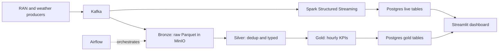

# Hi, I'm Isaac Tonyloi 👋

### Data Engineer · Cloud Engineer · Technical Writer

**I build reliable data platforms and self-healing cloud infrastructure, then explain them clearly.**

    

---

## 💡 What I Do

| Focus | What I deliver | Tools |
| --- | --- | --- |
| 🗄️ **Data Engineering** | Streaming and batch pipelines, medallion (bronze/silver/gold) lakehouse layers, data lineage and audit trails, data contracts, analytics modeling | Kafka, Spark, Airflow, dbt, PostgreSQL, MinIO, Parquet, OpenLineage |
| ☁️ **Cloud & Infrastructure** | Infrastructure as Code on AWS, auto-scaling and self-healing systems, serverless event-driven apps, chaos engineering, monitoring and alerting | Terraform, AWS (EC2, ALB, ASG, Lambda, S3, CloudWatch, SNS, FIS, IAM, VPC), Docker |
| ⚙️ **Platform & Backend** | Microservices with secure auth, message queues, caching, and CI/CD gates | Spring Boot, Kafka, Redis, Jenkins, Docker |
| ✍️ **Technical Writing** | Docs, tutorials, and articles that make data and cloud concepts easy to follow | Markdown, diagrams, runnable demos |

## 🧰 Toolbox

**Languages**

     

**Data Engineering**

      

**Cloud & Infrastructure as Code**

      

**Databases, Storage & Analytics**

    

**DevOps & Backend**

    

## 🏗️ Featured Projects

### 📡 [Call Tower Data Platform](https://github.com/isaactony/cell-tower-monitoring-solution)

An end-to-end data platform for cell tower (RAN) and weather data, running entirely on Docker Compose. Kafka feeds both Spark Structured Streaming for near real-time tables and an hourly Airflow-orchestrated medallion pipeline that lands bronze, silver, and gold layers in a MinIO data lake. Gold KPIs land in PostgreSQL and power a live Streamlit operations dashboard.

**Stack:** Kafka · Spark · Airflow · MinIO · PostgreSQL · Streamlit · Docker

### 🛡️ [Self-Healing AWS Infrastructure](https://github.com/isaactony/self-healing-infra)

Terraform-managed AWS infrastructure that detects and recovers from failure on its own: Auto Scaling Groups behind an Application Load Balancer with health checks across availability zones, CloudWatch dashboards and alarms, SNS alerts, and controlled chaos experiments (CPU stress and instance termination) using AWS Fault Injection Simulator. Built with least-privilege IAM and no hardcoded secrets.

**Stack:** Terraform · AWS (VPC, EC2, ALB, ASG, CloudWatch, SNS, FIS, SSM, IAM) · Spring Boot

### 📬 [Serverless Sentiment Inbox](https://github.com/isaactony/Serverless-Sentiment-Inbox)

A serverless, event-driven pipeline: drop an email into S3 and Lambda parses it, Amazon Comprehend scores the sentiment, keyword rules assign urgency, and the message is filed into sorted folders with a JSON analysis report. Fully deployed with Terraform, with versioned and encrypted storage and least-privilege IAM.

**Stack:** AWS Lambda · S3 · Amazon Comprehend · Terraform · Python

### 🔎 [Data Lineage and Audit Trail](https://github.com/isaactony/DataLineage)

A data governance project that captures lineage from eight example Python jobs (ETL, financial processing, data quality, ML, data lake ingestion, compliance) using OpenLineage, stores it in Marquez on PostgreSQL, and visualizes it as a live lineage graph. Ships with Docker Compose and a pytest suite.

**Stack:** OpenLineage · Marquez · PostgreSQL · Docker · Python

### 🧾 [dbt Data Contracts Demo](https://github.com/isaactony/dbt_contracts)

A small, runnable dbt project showing how a breaking schema change from a producer team gets caught in the pull request instead of surfacing days later in a downstream dashboard.

**Stack:** dbt · SQL · CI

### 🗃️ [pgmigrate](https://github.com/isaactony/pg-migrate)

A dependency-light CLI for versioned, reversible PostgreSQL migrations. Its dry-run runs the real migration inside a transaction and rolls it back, uses advisory locks to prevent racing deploys, validates checksums to detect drift, and refuses to fake safety for non-transactional statements like CREATE INDEX CONCURRENTLY.

**Stack:** Python · PostgreSQL · SQL

### 🛍️ [Retail Customer Analytics](https://github.com/isaactony/retail-customer-analytics)

A Contoso retail analytics stack with an ingestion layer, a warehouse, dbt models, and a Metabase BI layer, all started with Docker Compose and Make.

**Stack:** dbt · Metabase · Docker · Python

### 🧩 [Spring Boot Microservices Platform](https://github.com/isaactony/job-queue-system)

An 8-service microservices system with Eureka discovery, Config Server, an API Gateway, JWT authentication with role-based authorization, Kafka messaging, Redis, PostgreSQL, and file storage, all containerized with Docker.

**Stack:** Java · Spring Cloud · Kafka · Redis · PostgreSQL · Docker

## 🎯 What I Bring To A Team

| | |
| --- | --- |
| 🧱 **Reliability first** | Health checks, retries, locks, transactions, and chaos tests so systems fail safely and recover fast |
| 📐 **Production habits** | Infrastructure as Code, least-privilege IAM, tests, Docker-based reproducibility, and no secrets in git |
| 🔍 **Data trust** | Lineage, contracts, and quality checks so teams can rely on their data |
| ✍️ **Clear communication** | Strong documentation and writing that makes complex systems easy to adopt |

## 📊 GitHub Stats

 

## 📫 Let's Work Together

I'm open to **Data Engineer** and **Cloud Engineer** roles, and to freelance data, infrastructure, and technical writing projects.

| | |
| --- | --- |
| 🐦 X | [@IsaacTonyloi](https://x.com/IsaacTonyloi) |
| 💼 Freelance | Available on Upwork |
| 🌍 Location | Remote |

*Thanks for stopping by! ⭐ Feel free to explore my repos.*
